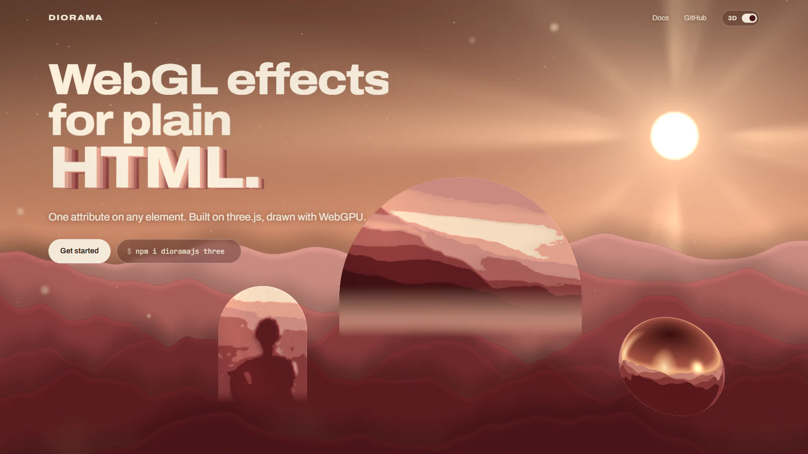

<p align="center">
  <a href="https://dioramajs.dev"></a>
</p>

<h1 align="center">dioramajs.dev</h1>

<p align="center">
  The website of <a href="https://github.com/MasterKurosava/diorama">Diorama</a>, three.js effects for plain HTML.
</p>

---

One Astro site, built with the library it documents:

- `/` is the landing page, a paper diorama from dusk to dawn. Each chapter shows one capability, from a photo set into the hills to frost you clear with the pointer.
- `/work/ridges` and `/work/lantern` are the pages the landing flies into, with keyed elements carried across the navigation.
- `/docs` is the documentation: getting started for every framework, guides, a gallery of all 100 effects with live examples, the API reference generated from the library sources, and pages for the errors the console prints.

Search runs on Pagefind with its own interface, code samples are type-checked at build time with Twoslash, and every docs page has a Markdown twin at the same address with `.md`.

## Run

Node.js 22.23+ or 24+ and pnpm. The library is linked from `../diorama` (the release repository, built with `pnpm build`) until it is published to npm.

```bash
pnpm install
pnpm dev        # http://localhost:4174
pnpm build      # static site in dist/
pnpm preview
pnpm check      # astro check and tsc
```

`pnpm build` reads the library first: `scripts/api.mjs` writes the API reference from its TypeScript sources and `scripts/meta.mjs` collects the effect metadata, both into `src/generated/`. A build fails on a broken link, a code sample that does not type-check, or an effect attribute the library does not know.

## Layout

| Path                  | Contents                                              |
| --------------------- | ----------------------------------------------------- |
| `src/pages`           | Routes: the landing, the work pages and the docs      |
| `src/landing`         | The landing page and its chapters                     |
| `src/content/docs`    | Documentation pages in MDX                            |
| `src/content/effects` | The hand-written parts of each effect page            |
| `src/examples`        | Live examples the docs embed                          |
| `src/effects`         | The site's own effects, written like any site's       |
| `src/docs`            | Docs layouts, components, search and Markdown plugins |
| `public/media`        | Photographs, models and sound                         |

## Deploy

`dist/` is a static site. Pages are written as `docs/start.html` and linked as `/docs/start`, so the host must serve `.html` files without the extension. `vercel.json` sets that up on Vercel, along with long caching for hashed assets.

## License

The code is [MIT](LICENSE). Photographs, scans, models, sound and fonts keep their own licenses, all public domain, CC0 or the SIL Open Font License; the [credits page](src/content/docs/credits.mdx) lists each one with its source.
